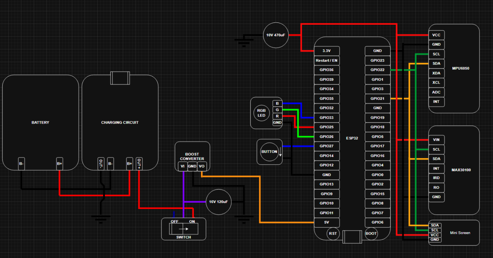
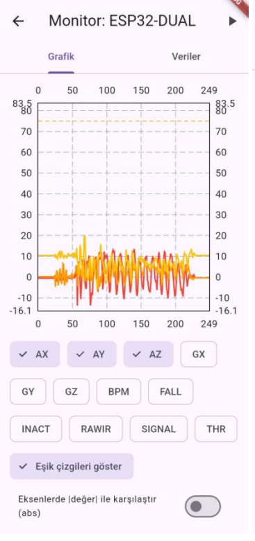
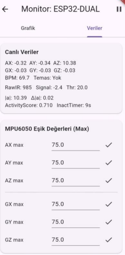

**BioTrack**

BLE-Based Wearable Health \& Safety Monitoring System

**Disclaimer**

BioTrack is an engineering and educational prototype. The measurements and detection algorithms are not intended to replace certified medical devices or professional medical assessment.

BioTrack is an ESP32-based wearable monitoring system designed to continuously collect biometric and motion data, analyze potential safety events, and transmit the collected information to a mobile application over **Bluetooth Low Energy (BLE)**.

The system combines heart-rate monitoring, motion analysis, emergency detection, and real-time mobile visualization in a compact wearable platform.

**Overview**

BioTrack is designed for scenarios where continuous monitoring and rapid awareness of potential emergencies are important.

The system collects:

* Heart rate data
* Infrared (IR) sensor data
* Accelerometer data
* Gyroscope data
* Activity information
* Fall detection status
* Inactivity status

The collected data is processed by an \*\*ESP32 microcontroller\*\* and transmitted to a Flutter-based Android application through BLE.

The mobile application provides real-time data visualization, configurable thresholds, and audio/notification-based alerts.

**System Architecture**

&#x20; 

**Hardware**

The wearable unit is built around an ESP32 microcontroller and includes the following components:

| Component          | Function                                           |

| ------------------ | -------------------------------------------------- |

| ESP32              | Data acquisition, processing and BLE communication |

| MAX30100           | Heart-rate and infrared signal measurement         |

| MPU6050            | Accelerometer and gyroscope measurements           |

| RGB LED            | Visual system status indication                    |

| OLED Display       | Heart-rate and contact-status display              |

| Emergency Button   | Manual emergency triggering                        |

| Battery            | Portable power source                              |

| Charging Circuit   | Battery charging                                   |

| 5V Boost Converter | Power regulation                                   |

| Power Switch       | System power control                               |

Features

Real-Time Heart Rate Monitoring

The MAX30100 sensor is used to acquire the user's optical IR signal.

The raw IR signal is processed using digital filtering and dynamic thresholding to calculate BPM (Beats Per Minute).

The system also detects whether the sensor is in contact with the user. Heart-rate measurement is disabled when sufficient contact cannot be detected.

Motion Analysis

The MPU6050 provides three-axis acceleration and gyroscope data.

The system calculates the magnitude of both acceleration and angular velocity:

|a| = √(Ax² + Ay² + Az²)

|gyro| = √(Gx² + Gy² + Gz²)

These values are used as the basis for the safety algorithms.

Fall Detection

A sudden change in acceleration is used to identify potential fall events.

The acceleration change is calculated as:

Δ|a| = ||a| - |a\_prev||

When the calculated change exceeds the configured threshold, a potential fall event is generated.

Inactivity Detection

An activity score is calculated by combining acceleration and gyroscope information:

ActivityScore = ||a| - 9.81| + K × |gyro|

If the activity score remains below the configured threshold for a predefined period, the system triggers an inactivity alarm.

**Emergency Button**

A dedicated physical button allows the user to manually trigger an emergency condition.

When activated, the event is transmitted to the mobile application and a high-priority notification is generated.

**Visual Feedback**

The RGB LED provides an immediate indication of the system state:

* &#x20;\*\*Green:\*\* User contact detected and no warning condition
* &#x20;\*\*Red:\*\* Warning or threshold violation detected
* &#x20;\*\*Blue:\*\* No user contact / measurement inactive

The OLED display provides the current heart-rate value and sensor contact status.

**Mobile Application**

The Android application is developed using **Flutter** and communicates with the wearable device through BLE.

The application consists of two main monitoring interfaces.

**Graph View**

&#x20; 

The graph interface provides real-time visualization of:

* Acceleration
* Gyroscope
* BPM
* Raw IR
* Signal
* Threshold
* Fall status
* Inactivity status

Individual data channels can be enabled or disabled using the application's checkbox controls.

Configured thresholds can also be displayed directly on the graphs.

**Data View**

&#x20; 

The data interface provides real-time sensor values in a text-based format.

It also allows configurable threshold values for monitored parameters such as BPM.

When a configured threshold is exceeded, the application can generate an \*\*audio alarm and notification\*\*.

Alert System

BioTrack uses both hardware and software feedback mechanisms.

Potential alert conditions include:

* Manual emergency button activation
* Detected fall
* Prolonged inactivity
* Abnormal heart-rate values

When an alert condition occurs, the system provides feedback through the wearable device and the mobile application.

This combination allows the user to receive immediate local feedback while also making the detected event available through the mobile interface.

**Power \& Mechanical Design**

The system is designed as a portable, wearable device powered by a battery.

A charging circuit and a 5V boost converter are used to provide a stable power supply for the system.

The hardware is assembled using a two-layer perforated board structure. Components requiring physical contact with the body, such as the MAX30100, are positioned on the lower layer, while the ESP32 and other control components are placed on the upper layer.

The two layers are connected using removable pins, screws, and nuts, allowing easier maintenance and future modifications.

**Communication**

Communication between the wearable device and the mobile application is performed using:

ESP32 → Bluetooth Low Energy (BLE) → Flutter Application

BLE was selected to provide wireless communication between the wearable hardware and the Android application while maintaining a suitable architecture for a portable monitoring device.

> The repository structure may vary depending on the current development state of the project.

\## Current Status

The core monitoring system has been implemented, including:

* ESP32-based sensor acquisition
* Heart-rate measurement
* Motion data acquisition
* Fall detection
* Inactivity detection
* Emergency button
* BLE communication
* OLED status display
* RGB LED feedback
* Flutter-based mobile monitoring
* Configurable monitoring thresholds
* Mobile audio and notification alerts

**Future Improvements**

Possible future improvements include:

* GPS integration for location tracking
* GSM/mobile network connectivity
* Remote monitoring over the Internet
* Cloud-based data storage
* Historical health and activity analysis
* Improved fall-detection algorithms
* Machine-learning-based anomaly detection
* Lower-power operation and battery optimization
* A more compact custom PCB design

GPS and GSM integration are particularly intended to extend the system beyond local BLE monitoring by enabling location-aware emergency communication over wider distances.

**Applications**

The BioTrack architecture can be adapted to different monitoring scenarios, including:

* Wearable safety systems
* Elderly monitoring
* Assisted-care applications
* Personal emergency detection
* Activity monitoring
* Pet monitoring

